# Towpath

A relaxing top-down browser game about travelling the UK canals on a narrowboat: steering, working locks, mooring at night. It's meant to be played in the background: the boat cruises by itself and calls you, with a soft bell and the tab's title, for the few moments it needs you.

It is built in TypeScript and SVG with Vite, with no game engine.

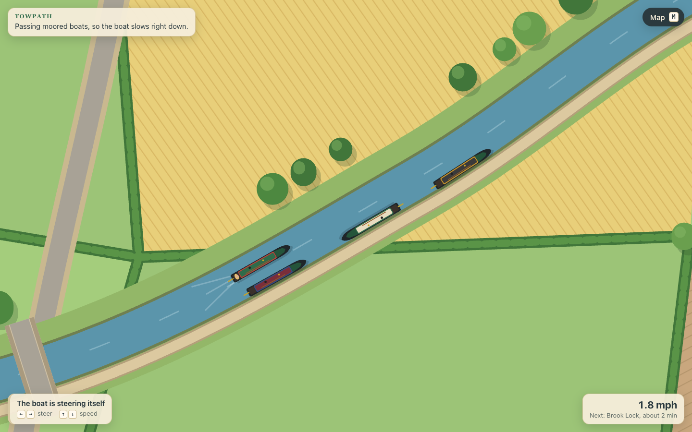

## What you can play

The first prototype is complete: all five build steps are in, so you can play a whole day, morning to morning, in about 20 minutes:

- **The canal and the boat.** One hand-made stretch, the Hallam Canal at Wendle. Cast off at Kingsbridge and the boat cruises by itself: under Hollin Bridge, slowly past the visitor moorings, up through Brook Lock and under Mill Bridge to Wendle Junction. From there it goes the way you choose: right down the Wendle Arm to the basin by The Navigation pub, or straight on along the main line to a quiet bank by Coppice Wood. Either way takes about 16 minutes, plus however long you take over the lock.
- **The camera.** A close view follows the boat, looking a little ahead. Press <kbd>M</kbd> for a guidebook map of the whole stretch, and <kbd>M</kbd> again (or <kbd>Esc</kbd>) to come back.
- **Taking the tiller.** Steer with the arrow keys (or WASD) whenever you like. Up and down change the speed, up to the four miles an hour speed limit. Let go for a few seconds and the boat finds its line again by itself. Bumping the bank or a moored boat is soft and does no harm. Near the lock, the junction and the basin, the boat steers itself.
- **Working the lock.** The boat ties up below Brook Lock and waits for you. The part that needs you next glows: click it, or press <kbd>Space</kbd>, and its close-up fills the screen. At a paddle, drop your windlass on the spindle, wind it round in circles, and take it off again; to wind a paddle down, flick the red safety catch off first, and keep hold, because with the catch off it drops if you let go. At a gate, walk the heavy balance beam round. A gate won't open until the water is level on both sides, and won't close on the boat. Every close-up also works from the keyboard: <kbd>Space</kbd> does the next thing, and held down it winds or pushes. The boat glides in and out by itself, and the gates swing shut behind you.
- **The other boat.** Another boat uses Brook Lock just before you, so how you find the lock depends on it. Coming down, it empties the lock and leaves the gates open for you: three close-ups. Going up ahead of you, it leaves the lock full, so you empty it first: six close-ups. Which it is comes down to luck, and starting again gives you the other.
- **The boat calls you.** The boat needs you to cast off in the morning, at every lock, before every junction where the ways part to choose one, and at dusk to choose where to moor. On the Hallam Canal that's four calls a day: casting off, Brook Lock, Wendle Junction and dusk. Each time a soft bell rings (made in the browser, once you've clicked or pressed a key in the page) and the tab's title says what it wants, so you can leave the game in a background tab. Press <kbd>Space</kbd>, or the button at the bottom, to answer. If you don't come, the boat waits: tied up at the lock, pulled in before the junction, or at the mooring. It rings again a couple of times if you stay away, says how long it has waited, and the bell can be switched off.
- **The junction.** Answer the junction call and the map opens with each way marked, as far as it goes before it parts again. Each says what's down it: where it leads, about how long it takes, and how many locks, or where you'll choose again. Pick one on the map, from the list, or with the number keys. Where the ways you can still take part again, the boat calls you again before that junction.
- **Dusk, night and morning.** The light goes as the boat nears its mooring. Choose one of the marked spots, and the boat glides in and ties up. Evening falls and the lamps come on in the boats, the houses and the pub, then night, then dawn: the end of the prototype day, ready to start another.
- **Life on the bank.** Walkers, joggers and dogs use the towpath all day: each comes on at a bridge or an end of the path, goes out a way, turns and goes back, keeping left as they pass. At Wendle Junction the towpath crosses the arm on the footbridge and carries on along the main line, and round the basin's quay to the pub garden. In the evening everyone still out turns for home, and the towpath is empty by the end of the night.
- **Life around the boat.** The boat leaves a wake of ripples behind it in the water, which spread to the banks and fade, with a faint trail along the way it has come. Ducks with their ducklings and pairs of swans swim slowly along the far bank and ease out of the way as a boat comes by, fish rise now and then, sheep and cows graze the meadows, and soft cloud shadows drift over the land and water.
- **The weather.** Each day has its own weather from the canal's seed and the day's number: some mornings are misty, and the mist lifts after you cast off and gathers again at dawn; some days a spell of drizzle comes and goes while you're underway. It changes only the look of the day, never how the boat goes.
- **The logbook.** The day is noted as it happens (casting off, each lock and how you found it, the way you took at each junction, where you moored, and how long the boat waited for you) and written up in the evening. Press <kbd>L</kbd>, or the Logbook button, to read it; the canal's seed is at the foot of the page.
- **Keeping your place.** Close the tab or reload it whenever you like: the game keeps your place in the browser and carries on exactly where it was, whether mid-lock or at night. Time doesn't pass while the tab is closed, so the boat is waiting where you left it.
- **Time keeps running.** The game keeps time by the clock, so the boat carries on while the tab is in the background. Browsers slow a hidden tab's timers to once a minute after a while, so a call can ring up to a minute late; the boat still stops at the right place and says how long it has waited.

| Casting off | Brook Lock | The map |
| --- | --- | --- |
| 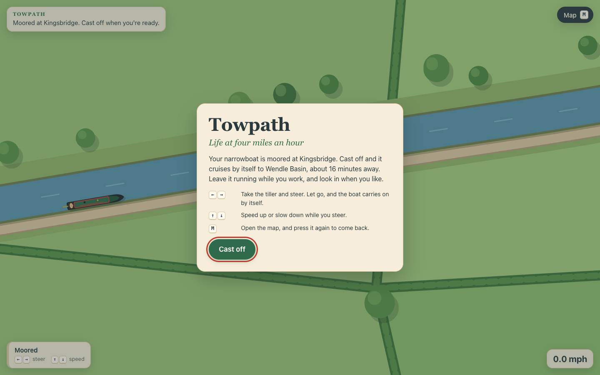 | 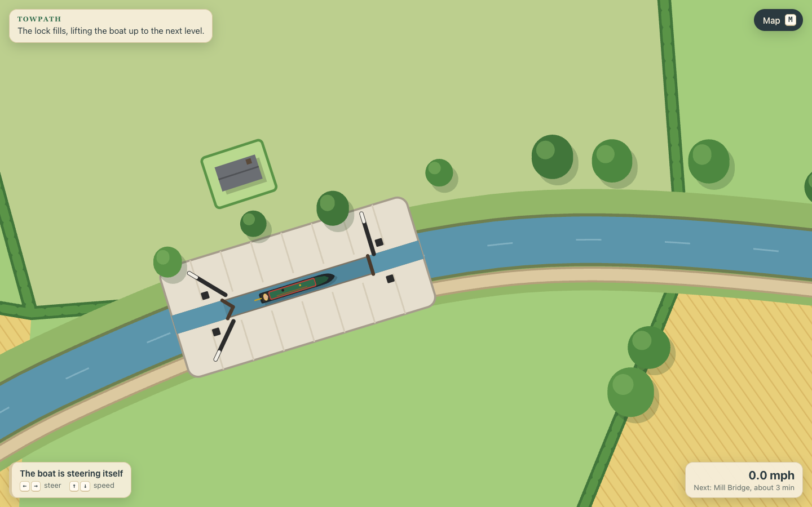 | 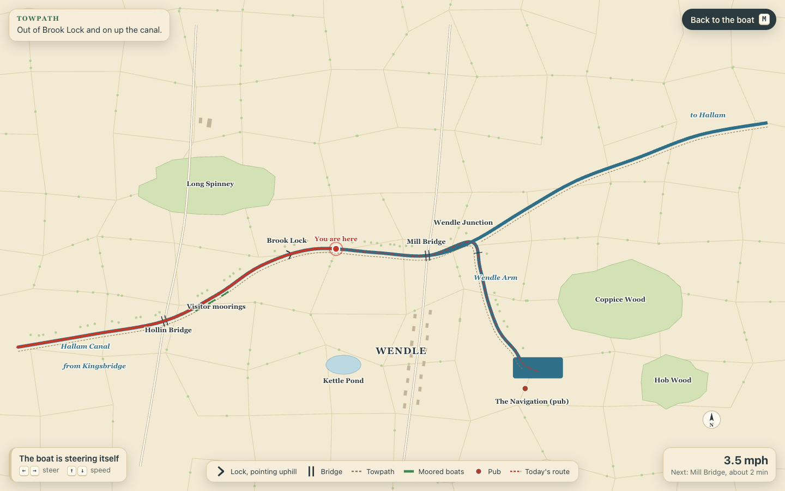 |
| **The boat ahead** | **Winding a paddle** | **Pushing a gate** |
| 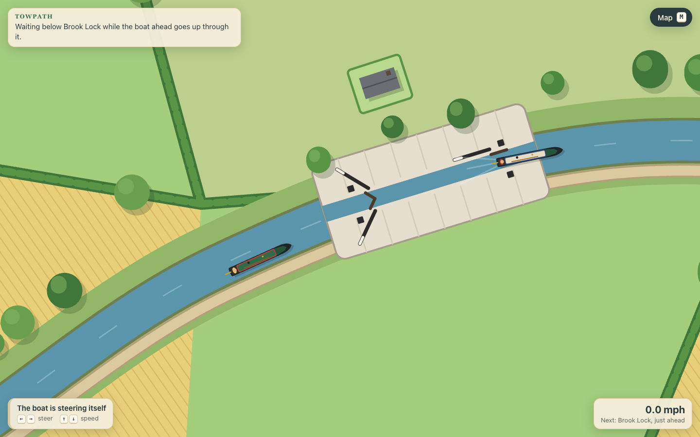 | 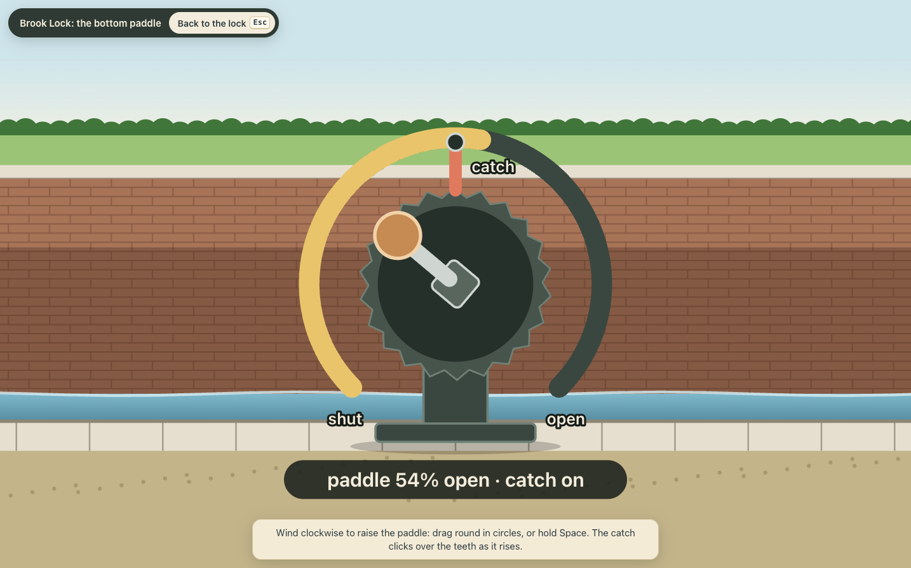 | 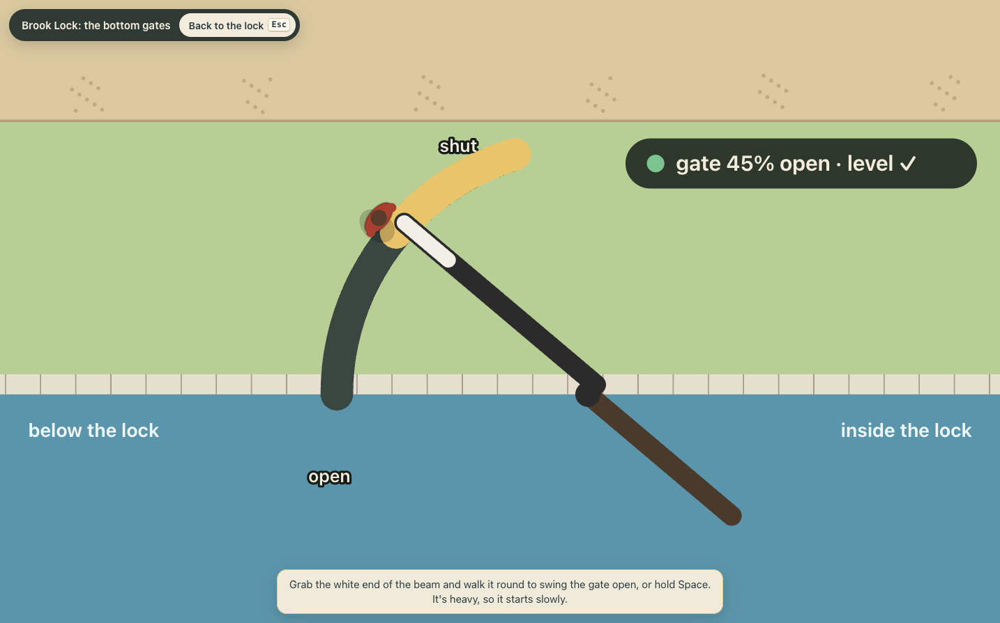 |
| **Which way at the junction?** | **Choosing where to moor at dusk** | **Night in Wendle Basin** |
| 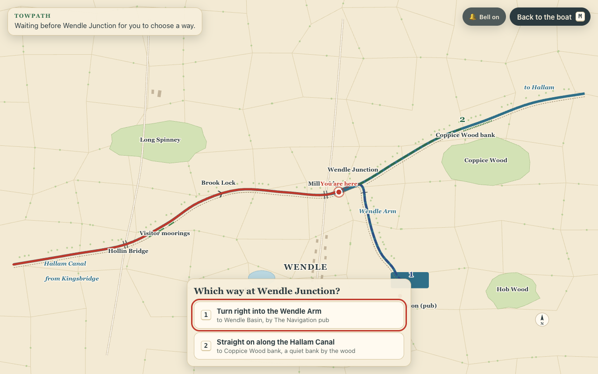 | 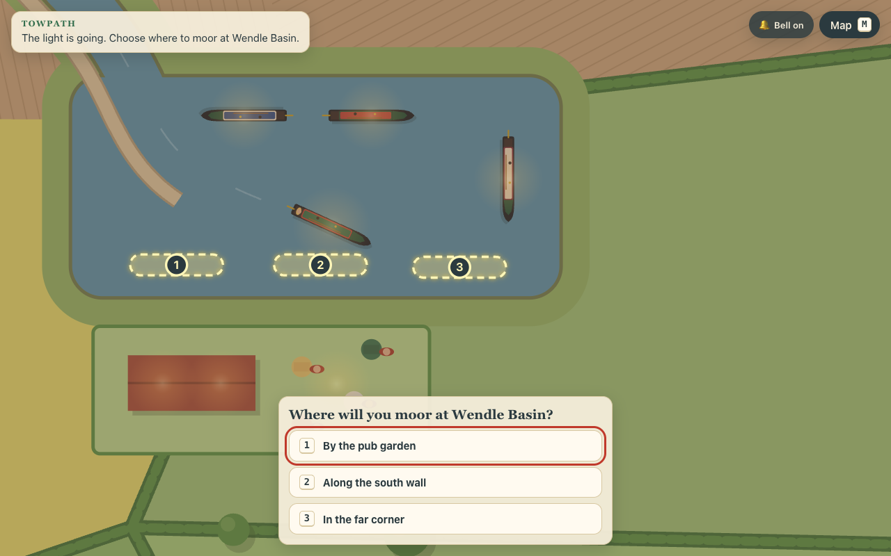 | 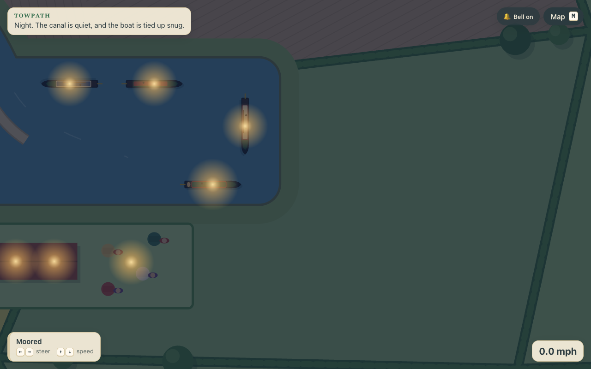 |
| **On the towpath** | **The logbook** | |
| 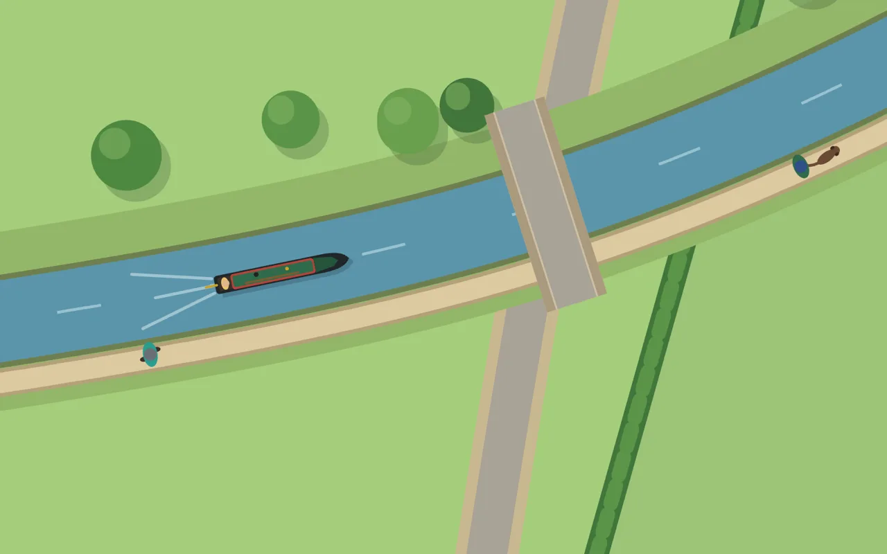 | 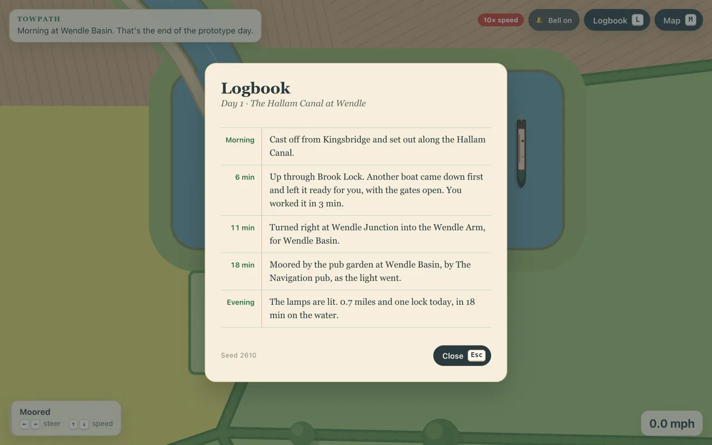 | |

## Run it locally

You need Node 24 (see `.nvmrc`) and [Socket Firewall](https://www.npmjs.com/package/sfw), which checks every package against known malware before it is installed. Install it once:

```sh
npm install --global sfw
```

Then run every install through it:

```sh
sfw npm ci                  # install the locked dependencies
sfw npm install <package>   # add a dependency
```

Run the game:

```sh
npm run dev      # open the printed local URL
```

To try things out without waiting, add `?speed=10` to the address to run the game ten times faster (anything from 0.25 to 60 works): a whole day then takes about two minutes, plus the lock. Add `?weather=mist`, `?weather=drizzle` or `?weather=clear` to choose the weather for every day (drizzle then falls from when you cast off until the evening). Add `?lock=ready` or `?lock=against` (or both, as `?speed=10&lock=against`) to choose how the other boat leaves Brook Lock on a new day. The game keeps your place between visits, so add `?fresh` to set it aside and start a new day.

`npm run build` writes a static build to `dist/`, and `npm run preview` serves it.

## Development

```sh
npm run lint       # ESLint
npm run typecheck  # TypeScript
npm test           # Vitest
npm run build      # type check, then a Vite build
```

The game's rules are kept apart from the drawing, so they can be tested without a browser:

- `src/core`: tracks (smooth curves sampled by distance), the fixed-step clock and small maths helpers.
- `src/world`: the stretch of canal, stored the way a map generator will make it: canals as points, a branch leaving its parent at a junction, features placed by distance along a canal, the ways a day can go and the moorings they end at, a towpath along every canal and its ways on and off, and a seed for the scenery.
- `src/sim`: the boat's steering, the lock's rules (water, gates and paddles, and the next job from any state), the hands-on paddle and gate in the close-ups, the other boat, the trip along one way, the boat's calls, the day from morning to morning (a choice at every junction where the ways part, mooring, and the light), the logbook, the people on the towpath, the day's weather and the clouds, the fish, birds and animals, the kept place (versioned: one from the version before is read across, and a stale or broken one starts a fresh day), and the words for what's happening.
- `src/view`: the camera, as plain maths.
- `tests/fixtures`: a hand-made test stretch with two junctions, one of them three-way, and three locks, for days with more than one choice.
- `src/render` and `src/ui`: the SVG painting (including the lock close-ups, the night, the people on the towpath, the wake, and the life and weather around the boat), the panels, the full-screen close-up, the logbook page, the keyboard and the bell.

CI runs the same four checks on every pull request and every push to `main`, and zizmor audits the GitHub Actions workflows.

## Reporting problems

Open an issue for bugs and ideas. For a security problem, see [SECURITY.md](SECURITY.md) and report it privately instead.

## Licence

MIT, see [LICENSE](LICENSE).
